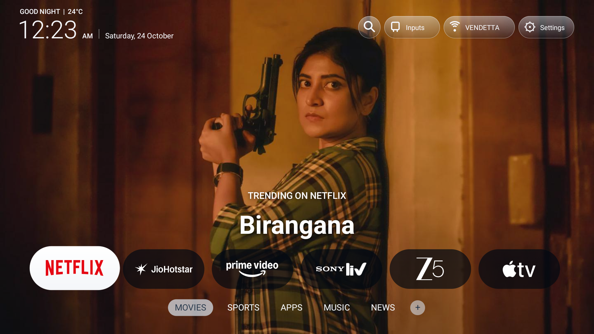
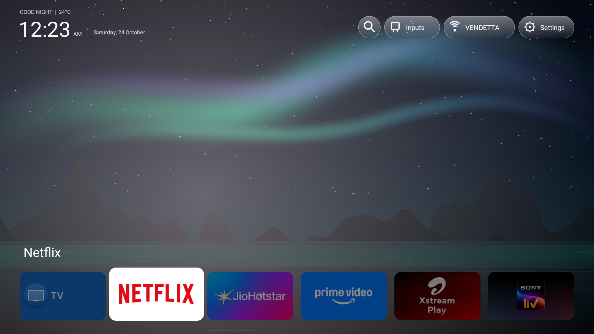
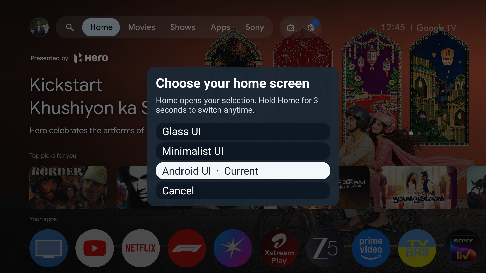
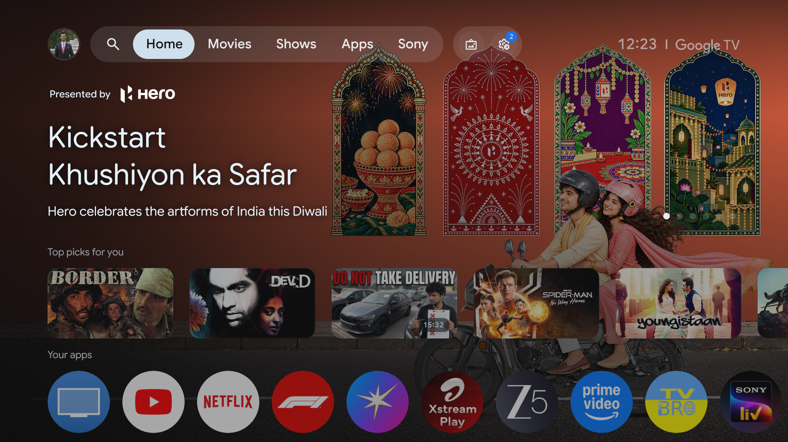
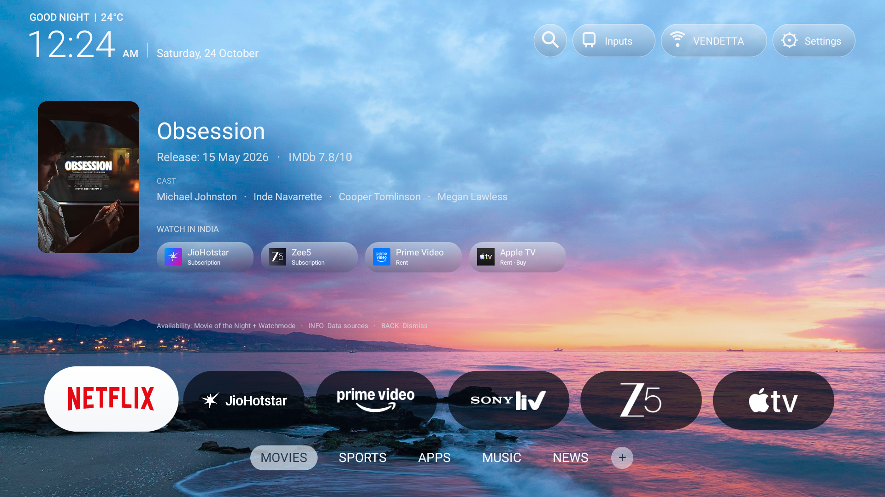
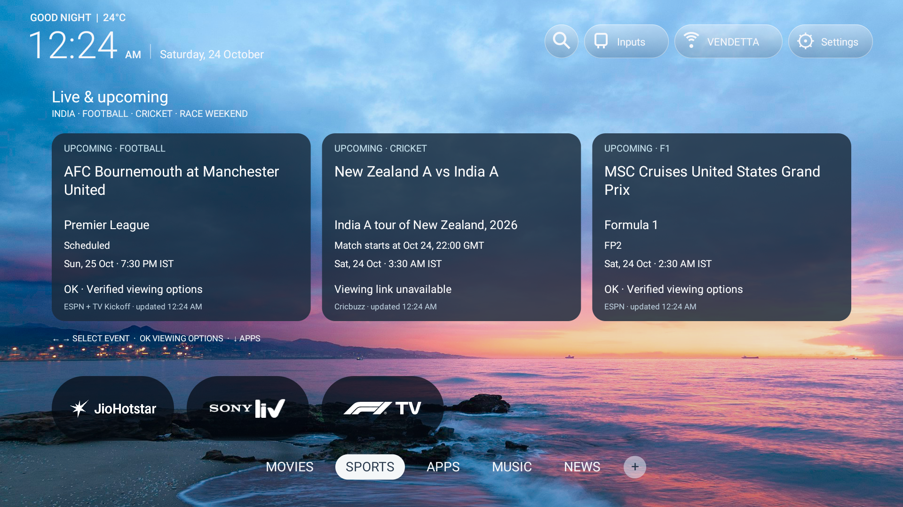
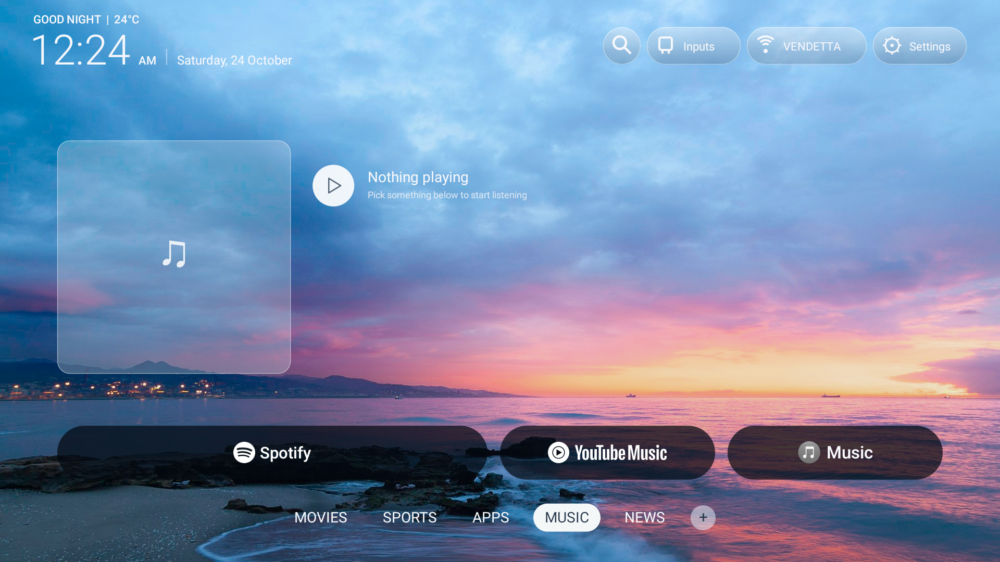
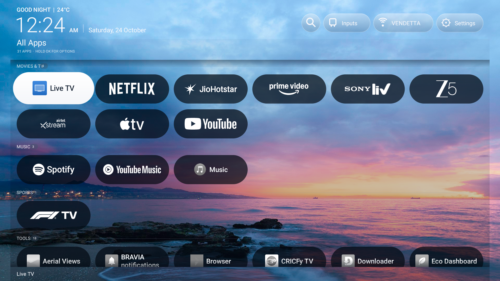

# Sony Bravia Unified Home

## Contents

- [About this repository](#about-this-repository)
- [Switch home screens](#choose-any-of-the-three-home-screens)
- [Which UI to use](#which-ui-to-use)
- [Features by UI](#features-by-ui)
- [UI captures](#ui-captures)
- [Code organization](#code-organization)
- [Local API configuration](#local-api-configuration)
- [Build, install and update](#build-install-and-update)
- [Development workflow](#development-workflow)
- [Test and verify](#test-and-verify)
- [Debugging and troubleshooting](#debugging-and-troubleshooting)
- [Contributor](#contributor)

## About this repository

One Android TV app with **Glass UI**, **Minimalist UI** and **Android UI**,
switchable through a three-second hold of the remote's Home button.

Glass UI provides a cinematic category-based home screen. Minimalist UI provides
a simple wallpaper, favourites dock and complete app library. Android UI opens
the TV's existing Google TV Home, including its native recommendations and controls.
Android UI is supplied by the TV; the APK contains the two custom presentations
and the shared Home router.

This independent merged repository keeps app order separate for each custom UI,
while sharing movie search, device controls and Home selection. Both original
source repositories remain unchanged; their historical names are recorded in
[merge provenance](docs/merge-provenance.json). Choosing a UI does not uninstall
or disable apps.

- Target device: Sony BRAVIA 4K VH22, Android 12/API 31.
- App ID: `tv.bravia.applehome`; minimum Android 8/API 26, compile/target SDK 35.
- Region: India; weather: Pimpri-Chinchwad.
- Local build output: **`outputs/sony-bravia-unified-home.apk`** (not published).
- Local JDK/Android tools build; no Gradle requirement and no service backend.

**Installation updates the existing custom launcher**, because it keeps the same
app ID and signing key. The original repositories and their APK files remain
unchanged. The signing key, API configuration and SDK are independent local
copies in this new directory, not symlinks to either original repo.

## Choose any of the three home screens

1. **Hold the physical Home button for 3 seconds** from either custom UI,
   Android UI, or another app.
2. The chooser lists **Glass UI → Minimalist UI → Android UI**, in that order.
   Select one and press OK.
3. Normal Home presses now return to that saved choice.
4. Hold Home again to choose another mode. Cancel leaves the choice unchanged.

Releasing before three seconds performs a normal Home press. The helper also
handles Sony's All Apps/Home delivery and routes Settings/Menu to Android Settings.

Keep **Sony Bravia Unified Home keys** enabled in Accessibility settings, including
while using Android UI. The TV's Google TV Home app must remain enabled too. The
custom Home router stays Android's default handler; the helper opens the selected
mode. If Android UI cannot be opened, Home falls back to Glass UI. A new install
starts with Glass UI. Each custom UI saves its ordering independently.

Updates preserve the selected UI, dock and library ordering. Legacy saved mode
IDs are translated to the new names, and the previous minimalist preference
store is copied once into `minimalist_ui`, without overwriting newer settings.
Only compatibility migrations and historical provenance retain old names.

## Which UI to use

| UI | Use case | What appears |
| --- | --- | --- |
| **Glass UI** | Browse streaming services, discover trending titles and follow live sport | Translucent app pills, rotating OTT artwork, Movies/Sports/Apps/Music/News categories |
| **Minimalist UI** | Quickly launch favourites with a quiet, readable home screen | Scenic wallpapers, up to eight dock apps, six-column Apps and Inputs panel |
| **Android UI** | Use native Google TV recommendations, integrations and system home features | The TV's installed Google TV Home |

The choice is saved across app restarts and shared by normal Home presses.
App installation remains device-wide: switching UIs does not create a separate
set of installed apps. App order is specific to each custom UI; the selected
search movie and response cache are shared.

## Features by UI

| Feature | Minimalist UI | Glass UI |
| --- | --- | --- |
| Visual style | Original rounded banner dock and deep-slate app panel | Translucent service pills with original-color focus |
| App organization | Dock plus complete Apps and Inputs library | Movies, Sports, Apps, Music, News, + |
| Dock/app row | Up to 8, add/remove through app options | Up to 8 in Movies; no add/remove menu |
| Full app library | 6 columns; initially alphabetical | 6 columns; priority apps, then alphabetical |
| App rearrangement | Dock and library; saved | Per category and library; saved |
| Wallpaper | Six scenic images, 2-minute crossfade | Light ocean category backdrop |
| OTT title previews | Not added to this UI | 5-second provider previews, title logos and artwork |
| Live sports widgets | Not added to this UI | Football, cricket and F1 |
| Search, metadata, OTT title links | Shared search implementation | Shared search implementation |
| Inputs, Wi-Fi/weather, app settings, uninstall flow | Shared device actions and existing UI | Shared device actions and existing UI |
| Playback pause, volume, Home chooser | Shared | Shared |

### Minimalist UI

- Scenic wallpapers rotate every two minutes, starting from a time-of-day scene.
- The dock starts with Live TV, Netflix, Hotstar, Prime Video, Xstream and Sony LIV.
  Up to eight apps can be placed on it. TV banners retain their proportions;
  missing banners fall back to app icons. Focus scales with card size.
- Down opens the complete six-column **Apps and Inputs** panel. Up from the first
  app row returns home. Left/Right wraps within the same row.
- Hold OK on a library app for **Move**, **Uninstall / system-app action**,
  **App settings**, and **Add to Dock / Remove from Dock**. Saved manual moves
  override the initial alphabetical ordering. Hold OK on a dock app to move it.
- Returning from the panel retains the existing Minimalist panel/dock animation.

### Glass UI

- Category order: **Movies → Sports → Apps → Music → News → +**.
- Left/Right previews a category while focus stays on the category bar.
  **Up, Down or OK** enters that category's apps/pane. Down from the app row
  returns to the bar. Up from the first Apps row or Back returns to it too.
- App pills are translucent dark at rest, white when focused, with white
  wordmarks changing to brand colors. Original icon proportions and proportional
  focus enlargement are preserved. Long utility names wrap.
- Apps initially presents two clear rows. Moving to the third row scrolls the
  grid and softly fades the preceding row. Left/Right wraps within the same row.
- Initial priority: Live TV, Netflix, Hotstar, Prime Video, Sony LIV, Zee5,
  Xstream, F1 TV, Apple TV, Spotify, YouTube, YouTube Music; remaining apps are
  alphabetical. Manual moves persist. The + pane groups apps by usage and hides
  the category bar when entered.
- Movies excludes Live TV, Airtel Xstream and YouTube. These remain in the full
  library. Movies and Apps share six-column pill proportions.
- Music has Spotify, YouTube Music and Music, lower-profile pills and a large
  empty artwork tile/play symbol. **Nothing playing** is a placeholder; this
  does not integrate every app's media-session artwork. News shows matching apps.
- Hold OK in a category to move its apps Left/Right. In Apps/+ use the long-press
  Move menu. Category and library ordering remain independent.
- Glass app options are **Move**, **Uninstall / system-app action**, **App settings**.
  Add to Dock and Remove from Dock remain absent from this variant.

### Android UI

- Opens the installed, enabled Google TV Home activity on this Sony TV.
- Uses Google's own layout, recommendations, app management and playback policy.
- A short Home press returns to Android UI after it is selected in the chooser.
- Hold Home for three seconds to return to Glass UI or Minimalist UI. Keep the
  Unified Home accessibility helper enabled so this works from Android UI too.
- Android UI is not rendered by the custom Canvas views. Custom search cards,
  Glass sports widgets and custom app ordering appear only in the custom UIs.

### Shared search, keyboard, movie cards and OTT links

Select the Search icon to open the TV's existing Google keyboard. Type a title
or use its remote microphone flow. No additional keyboard is installed; voice
input depends on the keyboard, remote and Google services.

- Suggestions update while typing. Back/keyboard Search hides the keyboard and
  focuses results. Up/Down selects, OK opens, Left returns to the query.
- Google suggestions are resolved to movie records. Metadata lookup uses OMDb,
  Movie of the Night and a Cinemeta fallback. Common suffixes and first-film
  queries are normalized.
- Movie cards show a poster, **Release: 23 Dec 2026** style date, IMDb rating,
  up to four cast members and available India providers. Info opens source credits.
- Up from the home app row focuses provider buttons when available. Left/Right,
  Down for another provider row and OK select/open a provider. Direct installed-app
  links are attempted, with a web-handler fallback. Back on Home dismisses the card.
- Availability is the union of Watchmode and Movie of the Night India results.
  Duplicate providers merge; subscription/free offers take priority over rental
  or purchase when the returned data supports that choice.
- Successes cache for **6 hours**; confirmed no-match/empty suggestions for
  **10 minutes**. Network/API failures are not recorded as confirmed misses.
- A selected movie suppresses Glass OTT previews until dismissed, so the two
  content presentations do not overlap.
- The selected movie is shared between layouts and refreshed when resuming a
  different custom UI. App order and layout state are not shared between modes.
- Coverage, prices, labels, account entitlement and title deep links depend on
  external services; the launcher cannot guarantee automatic playback.

**Search is a separate Java package with one controller and one implementation
of its associated lookup, availability, previews and artwork files.** Neither
UI embeds its own search implementation or accesses the search controller's
internal state. See [Architecture and file responsibilities](docs/ARCHITECTURE.md).

### Glass OTT previews and artwork

Supported OTT app focus displays **Trending on** / **Popular on**, the actual
title/logo and original backdrop for **both movies and TV shows**. Movies and
series are fetched separately per OTT and alternated in an eight-title rotation
(normally four of each). If one type has fewer titles, the other fills the
remaining slots. Titles rotate about every five seconds. The previous complete
card stays until the next artwork is ready, then fades
sequentially to avoid overlapping titles. Returning from Apps reuses loaded art.

Catalogs refresh on the Asia/Kolkata daily boundary, including while open. Failed
refreshes retain the prior card and retry after 15 minutes. Netflix, Prime Video
and Apple TV use official daily charts supplied by the catalog API; other
supported services use popularity catalogs and are labeled Popular on. If an
official chart has no titles of one type, that type uses its provider popularity
catalog and its cards are labeled Popular on. Separate movie/series caches
prevent old movie-only responses from hiding TV shows; partial refresh failures
retain available cached titles and retry after 15 minutes.
Movie and series catalog requests run concurrently. Switching providers can
reuse cached title metadata immediately; the old provider stops rotating while
the next provider loads. A failed catalog with no saved titles retries after
10 seconds; refreshing an existing stale catalog retains the 15-minute retry
interval. Missing artwork retries from cached metadata instead of being blocked
by the catalog refresh timer.

The next card's thumbnail and title logo are prepared together before switching,
so plain text does not change to a logo one second afterward. TMDB provides
original backdrops/title logos when available, otherwise catalog artwork/title
text is used. Original-resolution backgrounds can upgrade afterward without
changing the committed title treatment. Not every title has native 4K. Artwork uses a 256 MB
disk cache with decoded frames limited to current/outgoing cards.

### Glass live sports

Sports includes Sony LIV, JioHotstar and F1 TV when installed. Three widgets show
one football match, one cricket match and an F1 session during a race week;
otherwise a second cricket match fills the third slot.

- Football: all **UEFA Champions League** fixtures, **Barcelona in LaLiga**,
  and **Manchester United in the Premier League**. Live events take priority;
  upcoming events are limited to seven days.
- Scores/schedules: ESPN, Cricbuzz and Sony LIV. India broadcaster metadata:
  JustWatch/Sony LIV, event-ID/kickoff-checked TV Kickoff football listings and
  team/gender/start-time-checked TryBall India Women cricket listings.
- Only installed, event-identified broadcasters are offered. F1 TV is never an
  option for cricket or football. Unknown coverage says **Viewing link unavailable**.
- Publisher event links open directly when supported by the TV app; otherwise
  **Verified broadcaster · open app** opens the app for manual event selection.
- Up from Sports apps enters widgets. Left/Right selects an event; OK opens
  viewing options; Back closes them; Down returns to apps.

| Data | Refresh while Sports is visible |
| --- | --- |
| Cricket scores, F1, Sony live catalog | About 1 minute |
| Football schedules and scores | 5 minutes |
| India broadcaster listings | 5 minutes |

Polling stops when leaving Sports or pausing its activity; a request already in
flight can finish. Failed requests retain last successful data; older scores
show Cached. Sources can be delayed/incomplete. The app does not automatically
Google sports rights; Google was used to discover public sources during development.

### Device status, controls and playback

- Both layouts retain their headers, time/date/greetings, Celsius temperature,
  connected Wi-Fi name/signal and Search/Inputs/Wi-Fi/Settings controls. Glass
  retains its enlarged, aligned header; Minimalist retains its existing visual layout.
- Weather uses Open-Meteo for Pimpri-Chinchwad every 15 minutes; Wi-Fi status is
  read every 10 seconds. The device-status controller never changes Wi-Fi state.
  Weather shows `--°C` before a successful response. SSID visibility needs
  location permission and the TV's corresponding system settings.
- Inputs opens supported Sony tuner/HDMI/composite/component entries, deduplicated
  as in the source projects. Live TV launches Sony's TV app rather than Settings.
- Package installation/removal refreshes the visible UI's app list. Uninstall
  invokes Android's confirmation; protected system apps may only allow uninstalling
  updates or opening Settings. UI switching does not remove or disable apps.
- Returning to a custom Home sends media Pause, requests audio focus and repeats
  Pause after 350 ms and 1.2 seconds. Apps ignoring those signals may continue
  playing. Android UI uses its own policy. Apps are not force-stopped.
- Volume handling is shared, including system repeats and the existing timer
  fallback. Physical remote behavior still depends on Sony firmware/key delivery.
- Paused theme activities stop their status, preview and sports polling. Disposal
  cancels controllers/callbacks so switching layouts does not stack active pollers.

## UI captures

[Browse all 18 full-resolution PNG captures](outputs/photos).
The gallery covers Android UI, the three-second Home chooser, Minimalist UI,
app focus, search/results, Glass OTT previews, Sports, Music and both app panes.
Chooser order: **Glass UI → Minimalist UI → Android UI**.

| Glass UI · Netflix TV show | Minimalist UI · Netflix focused |
| --- | --- |
|  |  |

| Home chooser | Android UI |
| --- | --- |
|  |  |

| Glass movie search result | Glass Sports |
| --- | --- |
|  |  |

| Glass Music | Grouped All Apps |
| --- | --- |
|  |  |

These are native TV captures. Listings, scores and availability reflect the
capture time and can change. Only approved PNGs are included; configured APKs,
API credentials, capture logs and system metadata are excluded.

## Code organization

```text
launcher/app/src/main/java/tv/bravia/applehome/
  MainActivity.java                              Android HOME router; no theme rendering
  core/
    HomeMode.java                                The three stable mode IDs/labels
    HomeSelectionRepository.java                 Saved choice and legacy choice migration
    LegacyPreferencesMigrator.java               Versioned Glass/search and minimalist-state migration
    HomeNavigator.java                           Mode intent resolution, launch, fallback
    model/AppTile.java                           Immutable app identity/artwork model
  input/
    HomeGestureController.java                   3-second press state; duplicate-event guard
    HomeKeyService.java                          Accessibility key adapter
    GlobalButtonReceiver.java                    Sony global-key adapter
  ui/
    common/BaseHomeActivity.java                 Lifecycle, permissions, package receiver
    common/LauncherSurface.java                  Theme lifecycle and search adapter contract
    chooser/HomeChooserActivity.java             Three-mode chooser and Cancel
    minimalist/MinimalistHomeActivity.java       Minimalist surface factory
    minimalist/MinimalistHomeView.java           Minimalist Canvas layout, focus, menus/order
    glass/GlassHomeActivity.java                 Glass surface factory
    glass/GlassHomeView.java                     Glass Canvas layout, categories/focus/order
  device/
    AppLauncher.java                             App and Sony Live TV launch targets
    AndroidHomeResolver.java                     Enabled Google TV HOME resolution
    DeviceStatusController.java                  Read-only weather/Wi-Fi polling
    HomePlaybackController.java                  Media Pause/audio-focus policy
    VolumeController.java                        Shared volume press/repeat handling
  search/
    MovieSearchHost.java                         Theme-independent search adapter interface
    MovieSearchController.java                   Keyboard/results/card/provider UI controller
    MovieSearch.java                             Suggestions, metadata and cache
    MovieAvailability.java                       India provider union/cache
    ProviderPreviewCatalog.java                  Typed daily catalogs and movie/series mixing
    ProviderPreviewController.java               Glass preview artwork/rotation/transitions
    TitleArtwork.java                            TMDB backdrop/title-logo matching
  sports/
    SportsHost.java                              Sports host interface
    SportsController.java                        Widgets, event focus and viewing options
    SportsFeeds.java                             Publisher schedules/scores + football filter
    SportsAvailability.java                      JustWatch India event offers
    SportsBroadcastLookup.java                   Match-specific football broadcaster fallback
    SportsCricketAvailability.java               Dated cricket broadcaster matching
scripts/
  build.sh                                       Compile/sign without connecting to TV
  install.sh                                     Install/configure the final APK
  enable-home-keys.sh                            Rebind only this helper; preserve other services
  build-install.sh                               Build then install
  stock-restore.sh                               Earlier device-specific full stock restore
  test-tv.sh                                     Build/install + on-device integration checks
tests/instrumentation/                           Separate Android test runner (not in final APK)
outputs/sony-bravia-unified-home.apk             The single final configured APK
docs/ARCHITECTURE.md                             Contracts, flows, ownership and extension guide
.env / .env.example                              Private keys / placeholder template
ASSET_SOURCES.md                                 Artwork/data credits
work/android-sdk/, debug.keystore                Private local build dependencies
```

## Local API configuration

### Where to get each credential

Each service issues its own credential. Use the following providers and field
names; a key from one provider cannot be substituted for another.

| Local variable | Used for | Obtain and copy |
| --- | --- | --- |
| `OMDB_API_KEY` | Movie metadata, release date, cast and IMDb rating | Request a key from [OMDb API Key](https://www.omdbapi.com/apikey.aspx). Follow the email's activation instructions and copy the API key itself, not the activation URL or verification ID. |
| `WATCHMODE_API_KEY` | India streaming availability and title links, merged with MOTN | Create an account at [Watchmode Get API Key](https://api.watchmode.com/requestApiKey/). Include India in the account's enabled regions and copy the issued API key. |
| `MOVIEOFTHENIGHT_API_KEY` | Streaming availability, OTT movie/series catalogs and metadata | Sign up at the [Movie of the Night Developers Platform](https://developers.movieofthenight.com/) and copy the dashboard key. This app uses its direct API endpoint and `X-API-Key` header; a RapidAPI key requires different endpoint/header code. See [official authentication instructions](https://docs.movieofthenight.com/guide/authentication). |
| `TMDB_READ_ACCESS_TOKEN` | Original-resolution backdrops and official title-logo artwork for movies and TV shows | Open [TMDB account API settings](https://www.themoviedb.org/settings/api), request API access if needed, then copy **API Read Access Token**. Enter only the token, without a `Bearer ` prefix. This field expects the read token rather than the shorter API Key. See [TMDB application authentication](https://developer.themoviedb.org/v4/docs/authentication-application). |

### Configure locally

The current local checkout has private credentials in `.env`; a source-only
checkout includes only `.env.example`. Create a local file without overwriting
existing credentials:

```sh
# Run from your repository checkout.
cd sony-bravia-unified-home
cp -n .env.example .env
chmod 600 .env
```

Edit `.env` in your editor and replace all four placeholders with your own
values. Use one plain `NAME=value` per line, with no surrounding quotes or
`export` prefix; the build reads this file as properties, not as a shell script.

```properties
OMDB_API_KEY=YOUR_OMDB_KEY
WATCHMODE_API_KEY=YOUR_WATCHMODE_KEY
MOVIEOFTHENIGHT_API_KEY=YOUR_MOVIE_OF_THE_NIGHT_KEY
TMDB_READ_ACCESS_TOKEN=YOUR_TMDB_READ_ACCESS_TOKEN
```

Environment variables with these exact names override the file. If a previous
export is overriding a newly edited `.env`, unset it before rebuilding. Do not
paste real credentials into Java, XML, scripts, README examples or screenshots.

Rebuild and reinstall after changing or rotating any credential:

```sh
sh scripts/build-install.sh
```

The TV cannot read the Mac's environment after installation. Missing/invalid
keys limit the corresponding metadata, availability or artwork features; app
launching and the home-screen chooser remain available. Weather and sports use
public feeds and have no API-key fields in this configuration.

### What is private and what can be shared

- **Source:** Java/resources/docs contain no configured credential values;
  `.env.example` contains placeholders only.
- **Local configuration:** `.env` physically exists inside the local checkout
  and is private, mode `600`, and Git-ignored. `.env.*` variants are also ignored,
  with `.env.example` explicitly allowed.
- **Configured APK:** the build packages values into
  `assets/movie-api.properties`. They are extractable from the APK; an environment
  file prevents hardcoding in source, but does not hide credentials in an Android
  binary. Keep this APK private and do not attach it to a public PR or release.
- **Build staging:** the temporary private properties asset is removed after
  packaging. Build output, APKs, local SDK and signing key are Git-ignored.

Share the Git source/template, not a zip of the whole local directory. A folder
zip includes ignored files unless you explicitly exclude them. Review the files
being staged before publishing; `.gitignore` does not protect against a forced
add or remove a credential already committed to history. Revoke/replace any key
if its configured APK or private configuration is made public, then rebuild.

Check exclusions without displaying any credential values:

```sh
git check-ignore .env work/debug.keystore outputs/sony-bravia-unified-home.apk
git status --short --untracked-files=all
```

No commit, remote push or pull request is created by the build/install scripts.

## Build, install and update

### First setup from a source-only checkout

Clone this repository and enter its root directory. The published source excludes
credentials, the configured APK, Android SDK, generated build files and signing
key. Create `.env` using the API configuration section above.

Install a JDK and Android SDK command-line tools on your Mac. With `sdkmanager`
on PATH, download the expected SDK packages into this checkout:

```sh
sdkmanager --sdk_root="$PWD/work/android-sdk" 'platforms;android-35' 'build-tools;35.0.0' 'platform-tools'
export PATH="$PWD/work/android-sdk/platform-tools:$PATH"
```

For your own fresh installation, create a local development signing key once:

```sh
mkdir -p work
keytool -genkeypair -keystore work/debug.keystore -storepass android -keypass android -alias androiddebugkey -keyalg RSA -keysize 2048 -validity 10000 -dname 'CN=Android Debug,O=Android,C=US'
```

Keep that file for subsequent updates. **Do not replace an existing installation's
signing key:** a newly generated key cannot update an APK signed by another key.
The original local checkout already has its compatible key; the command above
is for new source checkouts. These public development passwords are not API
credentials and do not secure a production signing key.


### Requirements

- macOS, JDK providing `javac`, and `zip` on PATH.
- Local Android SDK 35/build-tools 35.0.0 under `work/android-sdk/`, copied here.
- Original signing key copied to `work/debug.keystore`; keep it for compatible
  in-place updates. A different key requires an uninstall/data reset.
- `adb` on PATH and an authorized, reachable TV for installation. Network ADB
  debugging must be enabled in Developer Options.

```sh
# Run from your repository checkout.
cd sony-bravia-unified-home
export BRAVIA_TV=192.168.68.104:5555
```

Compile without touching the TV:

```sh
sh scripts/build.sh
```

Install the existing final APK and configure Home/key routing:

```sh
sh scripts/install.sh
```

Or compile and install together:

```sh
sh scripts/build-install.sh
```

The build uses AAPT2, javac, D8, zipalign and apksigner. Every Java file is compiled
from this repo. It replaces the same final APK, cleaning intermediate APKs and
private staging files. A compilation failure leaves the earlier final file
unchanged. Installation uses `-r`, enables Google TV Home for Android UI, grants location,
sets the custom HOME router and enables the new key service while preserving
other accessibility services. The legacy helper component is removed from that
list; the saved home choice is retained/migrated.

Subsequent simple updates to an already configured TV can use:

```sh
adb connect "$BRAVIA_TV"
adb -s "$BRAVIA_TV" install -r outputs/sony-bravia-unified-home.apk
adb -s "$BRAVIA_TV" shell am start -n tv.bravia.applehome/.MainActivity
```

Always rebuild after source/resource/API configuration changes before deploying.

## Development workflow

1. Edit the file responsible for the change; use the file map above and
   [architecture guide](docs/ARCHITECTURE.md) to locate its owner.
2. Keep search work in `search/`; adapt `MovieSearchHost` rather than copying
   search code into either presentation. Device behavior belongs in `device/`,
   Home timing in `input/`, and selection/navigation in `core/`.
3. Run `sh scripts/build.sh` for a compile-only check. Compilation errors stop
   the build; fix them before installing.
4. Run `sh scripts/install.sh`, then perform the affected manual checks below.
5. For routing, preferences or lifecycle changes run `sh scripts/test-tv.sh`.
   It rebuilds and installs, so a separate install is unnecessary for that run.
6. Review changed and untracked files with `git status --short` and inspect the
   source diff. Keep `.env`, keys, APKs, caches, SDK and captures out of source changes.

The supplied scripts work in the existing local checkout with its copied SDK
and signing key. A source-only checkout needs those local prerequisites restored
before compiling; they are intentionally not part of Git. No pull request or
remote push is performed by these scripts.

## Test and verify

**Latest naming regression: 30 on-device checks passed**, including exact
UI labels and saved-state migration checks. Physical Home delivery was also confirmed
by the user before the naming update.
See [TV verification report](docs/TV_TEST_REPORT.md) for fixes, evidence and untested areas.

Run the on-device integration checks:

```sh
sh scripts/test-tv.sh
```

This builds/installs the current APK, installs a separately signed test runner,
checks mode selection, actual chooser-button navigation, three-second timing,
release behavior, short-Home routing, exact UI labels, legacy selection IDs and
preference migration, then restores the original Home selection. The temporary
test package/APKs are removed on exit, and the Home-key helper is explicitly
rebound to clear Android's post-instrumentation crashed-service marker. It
changes the active screen during the test and requires a connected/authorized TV.
A FAIL result makes the script exit unsuccessfully.

The harness invokes the application gesture controller; Android-injected Home
keys do not establish physical remote delivery. Confirm one actual three-second
remote hold separately. Search/provider/media flows need these visual checks:


1. Hold Home for 3 seconds; confirm all three choices and Cancel. Check shorter
   holds, normal Home, and switching from another app and Android UI.
2. Choose Minimalist UI: check the original dock, panel, six-column library, wallpaper
   crossfade, add/remove dock actions and saved ordering.
3. Choose Glass UI: check all six categories, Up/Down entry, app pills/fade, saved
   category moves, five-second OTT previews and event-specific Sports options.
4. Change app ordering in one theme, switch/restart, and confirm the other
   theme's order is unaffected.
5. Search Interstellar in each theme. Check keyboard/voice, suggestions, release
   date, cast, ratings, provider links, Back dismissal and shared selection/cache.
6. Check Inputs, Live TV, Settings, Wi-Fi name/signal and weather in both modes.
   Open an uninstall confirmation and Cancel unless removal is intentional.
7. Play media elsewhere, return Home, and check pause behavior. Check volume taps
   and holds on the physical remote. Repeat after switching layouts.
8. Confirm polling stops for the inactive theme. Check logs for crashes and
   graceful missing-data behavior when a public source/API is unavailable.

```sh
adb -s "$BRAVIA_TV" exec-out screencap -p > /private/tmp/bravia-unified-screen.png
adb -s "$BRAVIA_TV" logcat -d -s AndroidRuntime:E BraviaSports:W
shasum -a 256 outputs/sony-bravia-unified-home.apk
```

Keep working verification captures outside the repo. The approved UI gallery
lives in `outputs/photos/`; only its PNG files are shared. Configured APKs,
capture logs, temporary screenshots and SDK/build files stay excluded from Git.

## Debugging and troubleshooting

### Inspect the running app

```sh
# Confirm the TV is authorized and the HOME router is configured.
adb devices -l
adb -s "$BRAVIA_TV" shell cmd package resolve-activity --brief -a android.intent.action.MAIN -c android.intent.category.HOME

# Foreground activity and fatal Java errors.
adb -s "$BRAVIA_TV" shell dumpsys activity activities | rg 'mResumedActivity'
adb -s "$BRAVIA_TV" logcat -d -b crash

# Check the key helper is both enabled AND bound; inspect crashed services too.
adb -s "$BRAVIA_TV" shell settings get secure enabled_accessibility_services
adb -s "$BRAVIA_TV" shell dumpsys accessibility | rg 'Bound services|Crashed services|Sony Bravia Unified Home keys'

# Rebind the helper after instrumentation or if long Home opens Sony's menu.
sh scripts/enable-home-keys.sh
```

`enable-home-keys.sh` preserves other accessibility services, clears only this
app's old/current helper entries, then waits for actual service binding. An
entry in the enabled setting alone does not prove the helper is running.

For a focused visual check, open either custom UI directly using the commands
below. This does not change the saved Home choice. Keep screenshots and logs
outside the repository. Do not use `pm clear` or uninstall the launcher as a
routine fix: those operations erase saved choices, ordering and cached state.

### Common symptoms

- **ADB refused:** verify IP/debugging/authorization, wake the TV, then check
  `adb devices` and `nc -vz 192.168.68.104 5555`. Do not turn off Wi-Fi to troubleshoot.
- **Chooser unavailable:** check Accessibility → Sony Bravia Unified Home keys.
  Run `sh scripts/enable-home-keys.sh` to clear an unbound/crashed-helper state
  while preserving other accessibility services.
  Remote interception depends on Sony firmware delivering Home/All Apps events.
- **Android UI unavailable:** enable `com.google.android.apps.tv.launcherx`; installation
  does this automatically. Switching UIs does not disable Google TV Home.
- **Open a custom UI directly:**
  `adb -s "$BRAVIA_TV" shell am start -n tv.bravia.applehome/.ui.glass.GlassHomeActivity`
  (or `.ui.minimalist.MinimalistHomeActivity`). Direct developer launch does not change
  your saved choice; use the chooser to change what Home opens.
- **Missing movie/artwork data:** check private keys, quota, region and source
  availability; rebuild after key changes. Some deep links open a title/profile
  page rather than starting playback.
- **Missing SSID/weather:** check location permission, TV settings and network.
- **Restore Android's native default HOME:** normally use Android UI in the chooser. For a full restore, first
  disable this app's accessibility helper, review `scripts/stock-restore.sh`,
  then run `ANDROID_SERIAL="$BRAVIA_TV" sh scripts/stock-restore.sh`. That older
  device-specific script re-enables several Sony demo/support packages and
  changes Android's default HOME; it is broader than ordinary UI switching.

See [ASSET_SOURCES.md](ASSET_SOURCES.md) for artwork, brands and data sources.
This product uses the TMDB API but is not endorsed or certified by TMDB. Exact
fonts/textures/artwork availability depends on included assets and providers;
other Sony models may need different input and Google TV launcher components.

## Contributor

**[Shashank Dash](https://github.com/vendetta9)** is the sole contributor to this project.

## License and provenance

This project builds on [cleanyourtv](https://github.com/Gathin23/cleanyourtv).
The upstream MIT copyright and license are retained in [LICENSE](LICENSE).
App marks, artwork and external data have their own ownership and usage terms;
see [ASSET_SOURCES.md](ASSET_SOURCES.md).
