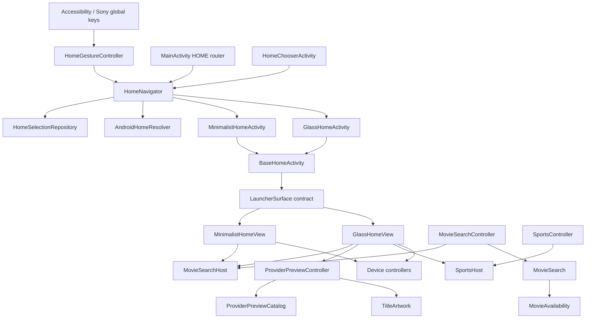

# Architecture and file responsibilities

## Design boundaries

This merge uses a single APK with two independent presentations. It does not
stack two APKs, duplicate the search feature, or switch between arbitrary
launcher packages pretending they are themes. Android UI is the TV's external, resolved Google TV HOME activity.

The source projects' Canvas presentation code is retained in `MinimalistHomeView` and
`GlassHomeView`: each owns its layout, focus/navigation, UI menus and app-order
policy. Shared device behavior has been extracted from those views. Their
Android lifecycle is owned by `BaseHomeActivity`, so switching presentation does
not duplicate package receivers or leave multiple active polling loops.

## Dependencies

Arrows represent usage/implementation; inheritance follows the corresponding
Java `extends`/`implements` declarations. Search and Sports consume their host
interfaces and never import a concrete Minimalist/Glass class. The preview
controller needs only Android `View` context/invalidation.

## Responsibilities and contracts

### Home selection and gesture

| File | Owns | Does not own |
| --- | --- | --- |
| `core/HomeMode.java` | Canonical IDs/labels for Minimalist UI, Glass UI, Android UI | Activity lifecycle or view state |
| `core/HomeSelectionRepository.java` | Saved choice and legacy ID canonicalization | UI or key timing |
| `core/LegacyPreferencesMigrator.java` | Versioned Glass/search and minimalist preferences migration | Repeated cross-theme synchronization |
| `core/HomeNavigator.java` | Destination intents, choose/save/rollback, Android UI fallback | Rendering or gesture detection |
| `device/AndroidHomeResolver.java` | Enabled Google TV HOME discovery | Live TV app launch or package disabling |
| `input/HomeGestureController.java` | Down/hold/up/cancel state; 3000 ms threshold; duplicate guard | Theme creation or preferences serialization |
| `input/HomeKeyService.java` | Accessibility callback adapter and Settings handling | Independent gesture state |
| `input/GlobalButtonReceiver.java` | Sony GLOBAL_BUTTON adapter | A second competing timer |
| `ui/chooser/HomeChooserActivity.java` | Three-choice/Cancel UI | Private theme fields or package-resolution rules |
| `MainActivity.java` | Stable Android HOME entry and dispatch | Either theme's rendering |

Gesture sequence:

1. First Home down arms a main-thread callback for `downTime + 3000 ms`.
2. Repeated/duplicate delivery does not start another gesture.
3. Threshold opens the chooser; releasing then does not additionally open Home.
4. Earlier release opens the saved Home mode. Canceled events do not navigate.
5. Chooser selection resolves the destination, saves the mode and opens it;
   an opening failure restores the previous selection.
6. Android UI is resolved as a HOME activity, never confused with Sony's tuner app.

### Theme lifecycle

`BaseHomeActivity` owns permissions, immersive flags, package-change receiver,
playback/audio focus and surface lifecycle. Each mode activity implements only
`createSurface()`. `LauncherSurface` defines the lifecycle/volume/search adapter
contract used by the activity.

When changing from one mode to another custom theme, navigation clears the old
custom task so its surface/artwork can be disposed. Normal Home presses in the
same mode reuse the activity. Per-theme ordering persists through preferences.

On resume the surface refreshes apps/shared movie selection, starts status
polling and its visible features. On pause it stops status/clock/wallpaper
callbacks, closes the keyboard, stops volume repetition, and deactivates Glass
previews/Sports. On destroy it disposes controllers and cancels animations.
Sports' drawing hook also checks `isForeground()` before activating its feed.
Requests already in flight may finish; disposed controllers do not publish
updates back into destroyed status listeners.

### Search and associated files

All search files have the real package `tv.bravia.applehome.search`, rather than
merely sitting in a directory while declaring the root package.

- `MovieSearchHost`: narrow view/focus/drawing adapter. No public mutable theme
  navigation fields are exposed to search.
- `MovieSearchController`: keyboard attachment/focus, debounce, results, detail
  card, provider navigation and launching. Owns its paint and request serials.
- `MovieSearch`: Google suggestions, OMDb/MOTN/Cinemeta metadata, title models
  and response/miss caching. Network work is initiated off the UI thread.
- `MovieAvailability`: India provider union, deduplication/access labels and cache.
- `ProviderPreviewController`: rotating preview cards, artwork lifecycle and
  transitions; consumed only by Glass presentation. Provider identity guards
  prevent an old catalog rotating during a handoff. Cached metadata decoding is
  independent of remote-refresh cooldowns. Thumbnail/title-logo preparation is
  atomic at card publication; optional original-resolution backdrop loading has
  its own worker and never replaces the visible title treatment.
- `ProviderPreviewCatalog`: separate movie/series queries and daily response
  caches, concurrent typed requests, source-aware chart/popularity fallback,
  deduplication and balanced
  eight-title mixing. A partial fetch keeps cached titles and remains eligible
  for a 15-minute retry. It has no focus, Canvas or animation responsibilities.
- `TitleArtwork`: TMDB title/backdrop/logo lookup used by the preview feature.

The two themes adapt the host interface. Neither copies network/search logic.
The saved selected movie and disk response cache are shared, while UI layout
preferences are not. Resuming a mode refreshes a changed/dismissed selection.

### Sports

The real package `tv.bravia.applehome.sports` contains the controller, host
interface, publisher feed adapter and separate broadcaster adapters. The
controller consumes `SportsHost` capabilities, not `GlassHomeView` fields.
`AppTile` is the shared immutable app model. The football filter is applied
across feed sources; broadcaster offers are matched by event, not sport alone.
Only Glass wires this feature in; Minimalist retains its original presentation.

### Device services

- `AppLauncher`: common Sony Live TV, Apple TV and installed-app launch targets.
- `VolumeController`: shared tap/repeat/fallback behavior with a stop operation.
- `HomePlaybackController`: idempotent Pause/audio-focus behavior on custom Home.
- `DeviceStatusController`: read-only Wi-Fi and weather data with explicit
  start/stop/dispose and a listener interface. It never mutates Wi-Fi settings.

The Canvas views retain per-theme app discovery/order, menus and input drawing
policy. A future UI rewrite can replace these renderers without changing Home
selection, metadata adapters, global gesture handling or device launch behavior.

## State ownership

| Store | Owner | Shared? |
| --- | --- | --- |
| `home_selection` | HomeSelectionRepository | Three-mode choice |
| `glass_ui` | Glass presentation | No |
| `minimalist_ui` | Minimalist presentation | No |
| `movie_search` | MovieSearchController | Selected movie |
| Application cache | Search/availability/artwork adapters | Response/artwork cache |
| `unified_migration` | LegacyPreferencesMigrator | Versioned migration markers |

Legacy `launcher` preferences are read for initial migration, not reused as a
common mutable layout store. Actual installed Glass settings can migrate;
separate historical Minimalist app data cannot be reconstructed from repository
source alone. Minimalist therefore starts with its source-defined defaults.

## Build and extending the app

`scripts/build.sh` compiles all real Java packages, creates one shared private
API asset, packages/signs once and cleans intermediate APKs/staging on exit.
`scripts/install.sh` handles TV configuration independently. This separates
local compilation from network/device side effects.

To add another mode: add a stable `HomeMode`, a mode activity/surface, an explicit
navigator destination and a manifest entry. The chooser enumerates `HomeMode`;
search continues to consume the same host contract. To add a broadcaster or
search source, change its adapter rather than either theme or Home key service.

These boundaries apply single responsibility, interface segregation, composition
for shared behavior and dependency inversion at feature/UI boundaries. Theme
rendering remains explicit rather than adding generic layers that would erase
the two original designs.

## Naming compatibility

The public choices are **Glass UI**, **Minimalist UI** and **Android UI**. Their
canonical persisted IDs are `glass`, `minimalist` and `android`. `HomeMode.fromId`
accepts the two previous stored IDs; `HomeSelectionRepository` writes the canonical
ID back without changing the selected UI.

Migration v1 imports installed Glass layout/search state. Independently, v2
copies missing keys from the legacy minimalist store into `minimalist_ui`,
including typed values and string sets. It preserves existing destination
values and records completion after the copy commits. This also runs on
installations where v1 already finished. Migration inputs are retained for
compatibility; normal UI code uses only the new store. Historical source names
in `merge-provenance.json` identify unchanged original folders.
